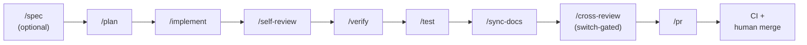

<div align="center">

# ralph

**Claude Code + Codex harness engineering.**

Scaffold, upgrade, and run opinionated agent harnesses that work with both Claude Code and OpenAI Codex from the same project — small always-on maps, on-demand skills, deterministic hooks, evidence-backed reviews, and an optional autonomous multi-seat execution surface (org runtime).

[](https://github.com/yoshpy-dev/ralph/actions/workflows/verify.yml)
[](https://github.com/yoshpy-dev/ralph/releases/latest)
[](go.mod)
[](LICENSE)
[](#install)
[](https://github.com/yoshpy-dev/ralph/releases)

[Why ralph?](#why-ralph) &middot; [Install](#install) &middot; [Quick start](#quick-start) &middot; [Features](#features) &middot; [Commands](#commands) &middot; [Operating loop](#operating-loop) &middot; [Org runtime](#org-runtime-autonomous-multi-seat-execution) &middot; [Language packs](#language-packs) &middot; [Portability](#portability)

</div>

## Why ralph?

Claude Code gives you a powerful agent, but the default setup is a blank slate. Repo-level harness conventions — rules, skills, hooks, subagents, verification scripts — have to be invented, maintained, and upgraded by hand, and they drift fast across projects.

`ralph` ships those conventions as a distributable, upgradable scaffold.

| | Bare Claude Code | `ralph init` |
|---|:---:|:---:|
| Always-on map (`AGENTS.md` / `CLAUDE.md`) | — | ✓ |
| On-demand skills (spec, plan, implement, verify, ...) | manual | 10+ bundled |
| Deterministic hooks (mojibake guard, commit-msg, bash guard, ...) | manual | pre-wired |
| Evidence-backed pipeline (self-review → verify → test → sync-docs → cross-review) | ad hoc | canonical order, enforced |
| Isolated task execution | ad hoc branches | clean-base task worktrees |
| Autonomous multi-seat execution | — | org runtime (`ralph org`) |
| Language packs (TS, Python, Rust, Go, Dart, Terraform) | — | opt-in |
| Drift management between projects | manual copy | `ralph upgrade` |
| Cross-agent portability | — | portable `AGENTS.md` + scripts |

## Install

```sh
# Homebrew
brew install yoshpy-dev/tap/ralph

# Or install script (verifies SHA256 against GitHub Releases)
curl -fsSL https://raw.githubusercontent.com/yoshpy-dev/ralph/main/scripts/install.sh | sh
```

Verify:

```sh
ralph version
ralph doctor
```

## Quick start

```sh
ralph init my-project
cd my-project
ralph doctor                  # environment check (Claude Code or Codex)
```

Both agent surfaces are wired up automatically. To make Codex's project-level config
load, run `codex trust .` once after `ralph init`. Hooks additionally need a
one-time interactive approval — run `codex` interactively at least once so
you can review and approve the shipped hook (see `.codex/README.md`'s Hooks
section). `ralph doctor` flags config-trust gaps and `hooks.json` wiring
problems, but cannot check hook-approval state.

Create your first plan and run the loop inside Claude Code. Prefer the skills
because they create clean-base task worktrees before writing plan artifacts:

```
/plan
```

The lower-level `./scripts/new-feature-plan.sh` helper remains available
inside an already resolved task worktree.

In Claude Code, follow the loop with slash commands:

```
/spec (optional) → /plan → /implement
→ /self-review → /verify → /test → /sync-docs
→ /cross-review (switch-gated) → /pr
```

In Codex, the same flow runs via skill mention syntax (`/spec` collides with
Codex built-in slash commands — use `$skill-name` or the `/skills` menu):

```
$spec (optional) → $plan → $implement
→ $self-review → $verify → $test → $sync-docs
→ $cross-review (switch-gated) → $pr
```

`/plan`'s plan advisory and `/cross-review` ask the other CLI (Claude Code →
Codex, Codex → `claude -p`) for a second opinion only when
`[standard].plan_advisory` / `[standard].cross_review` in `ralph.toml` is on
(both default off) and that CLI is available. Otherwise the step is skipped,
and the skip is recorded on the plan's Progress checklist, in the
cross-review triage report, and in the PR body.

For autonomous multi-seat execution outside this interactive loop, see
[Org runtime](#org-runtime-autonomous-multi-seat-execution).

Before claiming a task is done:

```sh
./scripts/run-verify.sh
```

## Features

| | |
|:---|:---|
| **Maps, not manuals**<br/>Short `AGENTS.md` / `CLAUDE.md`; push detail into rules and skills, promote repeats into hooks. | **Canonical pipeline**<br/>`self-review → verify → test → sync-docs → cross-review → pr` enforced in the standard flow. |
| **Deterministic hooks**<br/>Mojibake guard, commit-msg secret scan, Bash guardrails, verification reminders — pre-wired in `settings.json`. | **Worktree-first flow**<br/>Spec, plan, implement, and PR artifacts are produced from clean-base task worktrees, with local cleanup after hand-off. |
| **Org runtime**<br/>Autonomous multi-seat execution (`ralph org spawn/send/wait/...`) with a typed messaging protocol and pulse-layer watchdog — see [Org runtime](#org-runtime-autonomous-multi-seat-execution). | **Language packs**<br/>TypeScript, Python, Rust, Go, Dart, and Terraform starters (opt-in) with per-language `verify.sh` and path-scoped rules. |
| **Drift-proof upgrades**<br/>Fully non-interactive `ralph upgrade` — core replace, managed-block update, and settings 3-way merge, with an upgrade report and a dedicated exit code for unresolved drift. | **Evidence over prose**<br/>Every self-review, verify, test, sync-docs, and cross-review triage pass produces a dated artifact in `docs/reports/`. |
| **Cross-agent portable**<br/>`AGENTS.md` + `scripts/` + `packs/` stay neutral; `.claude/` and `.codex/` are agent-specific layers you can stack others beside. | **Local state, not repo churn**<br/>Worktree lifecycle records live under `git-common-dir`, outside tracked files and branch checkouts. |

## Commands

| Command | Purpose |
|---------|---------|
| `ralph init [name]` | Scaffold a new project. Interactive: asks which language packs to install (the `--pack <name>` packs selected at first, else none; marker-file matches labeled "(Recommended)"; plus a "skip" option). `--yes` asks nothing and installs only the `--pack` packs (repeatable or comma-separated); `ralph pack add` adds one later. |
| `ralph upgrade` | Non-interactively pull template updates; auto-migrates legacy (pre-v2) layouts first (see [`ralph upgrade`](#ralph-upgrade)). |
| `ralph eject <path>` | Convert a core-owned scaffold path into a user-owned fork (zero disk writes); upgrade stops replacing it. |
| `ralph adopt <path>\|--all` | Reset a fork or drifted core path back to `owner=core`, overwriting it with the current embedded template. |
| `ralph org spawn/start/send/wait/read/watch/report/stop/status/disband/escalate/inbox/approve/gate/merge-order/merge/regate/cleanup/director` | Manage org-runtime seats for autonomous multi-seat execution. `escalate` raises an item (QUESTION, BLOCKED, or RESULT) in the org inbox that every org in the ledger shares; with `[org.director].enabled` (default true) and a watch accepting work it only records the item for the director, and the watch sends it to the human at the ack deadline, otherwise it also notifies the human at once; `inbox` lists the items and shows, acks, resolves, or sends one to the human now, and `wait --inbox` waits for an open item; `wait --inbox --director <id>`, the director's wait, waits only while `<id>` is the current registration, writes its own mark (`<state dir>/director-wait.json`), and exits 4 when a watch that accepted work no longer does (and no item is open) and 5 when its registration is not current. `approve <inbox ID>...` records a human's approval of the feature plans that leaders asked for in the inbox, which an org in approval mode `per-plan` needs before its implementer is spawned or given a `TASK`; it resolves nothing and prints the `ralph org send` that tells the leader, then the `ralph org inbox resolve` to run once that send succeeded. `director attach/detach/status` keeps the ledger's director registration (`<state dir>/director.jsonl`) for the session the `/director` skill promotes, with how it learns of new items (`--wake pull\|push\|pull,push`, default `[org.director].wake`), and `director start/stop` starts and stops a headless director in a herdr workspace of its own, or with `[org.director].launch_cmd` in a terminal that command opens, recorded in the same file; start first cleans up a current headless director that has ended. `gate` runs `run-static-verify.sh` and `run-test.sh` on a feature org's rebased head and records whether it passed, on which base, before its leader opens the PR. `merge-order` lists the feature branches in the order their PRs may be merged now, from the gate records and origin's branches. `regate --branch <branch>` brings the branch of a disbanded feature org back to `ready` after another PR's merge: it merges origin's default branch in with a merge commit, runs the gate there, records it, and pushes without force. `merge --branch <branch>` merges with `gh` the PR of a branch merge-order lists as `ready`, after it has checked the PR, its checks, and GitHub's protection of the default branch again, live (no merge queue, and an up-to-date rule with required checks of its own that the caller cannot bypass), and records `pr_merged`; `[org.director].auto_merge` (default true) lets the director run it and `regate` without asking; `merge` then removes the feature worktree, the local branch, and the `scripts/ralph-worktree.sh` record, and `cleanup [--branch <branch>]` does the same for a PR merged on GitHub. `watch --all` is one process per ledger that watches every running org (stall, liveness, and scope-change ALERTs to its leader, and an `ALERT` item in the inbox for an ALERT the leader did not act on or one about the leader) and the inbox deadlines, checks whether the current headless director is still alive (`<state dir>/director-alive.json`), and wakes a director registered with push for new inbox items; `--detach` starts it in the background, logging to `<state dir>/watch.log`, and `--stop` asks it to stop; the single-org `--org-id` form is retired. `stop` closes the seat's herdr pane and `disband` closes the org's herdr workspace; `stop --all` / `disband --all` act on every org_id without `--org-id`. `start` and a leader's `spawn` take `--reserve <path>` (repeatable; relative to the repo root, a trailing `/` is a directory, `.` the whole repo) to claim part of the repo for the org until `disband`; a reservation that overlaps another running org's is refused. `start --plan <split plan> --feature <slug>` starts the org for one feature of an approved split plan in its own worktree and branch (see [Org runtime](#org-runtime-autonomous-multi-seat-execution)). |
| `ralph status [--org-id <id>] [--state-dir <dir>]` | Show scaffold ownership (core/fork/seed/block) and unresolved drift, plus org roster status, each org's watch heartbeat, an `org watch:` line saying whether `ralph org watch --all` is running (`running (--once)` for a one-cycle watch), stopping while it drains, stale, or not running, then a `director:` line and a `merge guarantee:` line (table or `--json`, where those lines are `org_watch`, with `once` set for a `--once` watch, `director`, and `merge_guarantee`). The `director:` line shows the ledger's director registration and `[org.director].enabled`: `attached` (with the registration's id, driver, attach time, and who attached it, and for a headless director its state, `starting` or `running`, model, pane, and workspace, or, for one launched with `[org.director].launch_cmd`, `launch cmd`, its terminal's name, and its pid in place of the pane and workspace, with `terminal_name` in `--json`), `not attached`, `disabled` (`enabled = false`, so escalate sends every item to the human at once), or `unreadable` when `director.jsonl` cannot be read. For a promoted session a registration does not mean the session is still running, and the line adds what the mark of its `ralph org wait --inbox --director` says: when that wait started and last wrote its mark, when and how it ended, or that there is no mark (`director.wait` in `--json`), which is what the wait wrote, not that the session is alive; for a headless director the line says instead what `ralph org watch --all` found when it last checked it (`checked by the watch at <time>: alive (<how>)`, `ended (<how>)`, or `unknown (<how>: <detail>)`, or `not checked yet` before the watch has checked this registration), and for an ended one it names the `ralph org director start` that cleans it up and the `ralph org director stop --id` that stops it (only the stop with `enabled = false`); `--json` has it as `director.check` (`state`, `how`, `checked_at`, `detail`). `attached` and `not attached` also say what `[org.director].auto_merge` (read by the same rule as `enabled`) means: merges are left to the human (`false`), or a director merges the PRs `ralph org merge-order` lists as ready with `ralph org merge`, without asking (`true`); `disabled` says that `auto_merge = true` has no effect, and `--json` has `director.auto_merge`, `false` included. A headless director that is no longer attached but still open is named at the end of the line with its stop command (`open_headless` under `director` in `--json`). The `merge guarantee:` line shows the kind `ralph doctor`'s `Merge guarantee` check last cached in `<state dir>/merge-guarantee.json` (`github_protection`, `pr_checks_only`, or `unknown`), with the default branch, origin's repository, and when doctor checked it, or `unknown` with the reason: no org ledger yet, no cache (run `ralph doctor`), a cache that cannot be read, a cache more than 24 hours old, or an origin whose host or owner/repo is not the one doctor checked (compared without case) or cannot be read here. status runs no `gh` and does not use the network. For the `merge guarantee:` line git runs only the local `git remote get-url origin`, and only when the cache is fresh; besides that, status runs the local `git rev-parse` (and `git worktree list --porcelain` in a linked worktree) that finds the main worktree: without `--state-dir`, to find the [`ralph.local.toml`](#ralphlocaltoml) whose `[org].state_dir` names the state directory when it is set, and to resolve the state directory when neither names it; and, when one of them does, to tell whether it names the main worktree's ledger, whose `ralph.toml` then holds `[org.director].enabled`, whether or not the cache is fresh. Each `ralph.toml` it loads (`./ralph.toml`, and the main worktree's when the ledger is the main worktree's) runs the same local git calls once more, from that file's directory, to find `ralph.local.toml`. |
| `ralph pack add <lang>` | Install a language pack. |
| `ralph doctor [--strict] [--state-dir <dir>]` | Check Claude Code, Codex, hooks, manifest drift, language packs, and the merge guarantee of origin's default branch. It passes when either Claude Code or Codex is usable: the one that is not usable is `warn`, because the plan advisory and cross-review that call it will not run. It fails when neither is usable, or when a CLI that `[doctor].require_claude_cli` or `require_codex_cli` (both `false` by default) sets to `true` is not usable. A missing herdr or agmsg is `warn` (org runtime seats are unavailable; the standard flow is unaffected), and a `warn` never changes the exit code. `--strict` exits 1 on any core-hash mismatch, block damage, settings-key drift, conflict marker, or manifest/disk mismatch — and on any meta-failure that makes one of those checks impossible to run (e.g. an unparseable manifest or an unreadable tracked file) — the CI-grade integrity gate. Block/settings-key checks compare against the *current binary's* templates with no pending-update tolerance (unlike the core-hash check, FR-4) — run `ralph upgrade` before `doctor --strict` right after upgrading the `ralph` binary itself, or a version-skew pending update reads as scaffold damage. The `Merge guarantee` check reads the protection of the default branch of origin's repository (the host and owner/repo of `git remote get-url origin`, so in a fork's checkout the fork, not the repository its PRs merge into) with up to 4 `gh api` calls, which share one 20 s deadline with that git call: the repository's `default_branch`, the active rulesets' rules through `rules/branches/<branch>`, the classic branch protection's required status checks, and, only when that protection requires a check, its `strict`, which needs admin access. Every call passes `--hostname <origin's host>` (`ssh.github.com` is read as `github.com`; an ssh alias such as a `Host` in `~/.ssh/config` is not resolved, so `gh` fails on it), and no `gh` runs when `gh` is not on PATH. It is `pass` for `github_protection` (a ruleset or the branch protection requires branches to be up to date before merging, or a ruleset has a merge queue, with at least one required status check), `warn` for `pr_checks_only` (no such setting, or one with no required check; the detail says what to set), and `info` for `unknown` (origin, `gh`, or the branch protection's `strict` cannot be read, or the deadline passed; the detail says why), and never `fail`. When the org ledger's directory already exists it caches the result, `unknown` included, in `<state dir>/merge-guarantee.json` for `ralph status` and `ralph org merge-order`; it never creates that directory, and when the write fails it removes the old cache, and is `warn` if that fails too. The ledger is `--state-dir`, else the one the `ralph org` verbs resolve (`[org].state_dir` in [`ralph.local.toml`](#ralphlocaltoml), else the main worktree's `.harness/state/org`); when it cannot be resolved, an `Org ledger` line fails with the error, the other checks go on, and nothing is cached. |
| `ralph config get <key>` | Print one value of `ralph.toml` (the `--config` file, else `./ralph.toml`) by its dotted name, such as `standard.cross_review` or `org.review.max_cross_review_cycles`, on stdout: `true`/`false`, a number, or a string as written. The value is the one after [`ralph.local.toml`](#ralphlocaltoml) is applied: a key that file sets prints its value. A key neither file sets prints its built-in default, also when neither file exists. Exit 2: the key is not a key of one value (unknown, or a table or an array). Exit 3: the file or `ralph.local.toml` cannot be read, cannot be parsed, or fails validation; a `ralph.toml` that sets a key only `ralph.local.toml` may set (`[org].state_dir`, and the five keys the scripts read, described under [`ralph.local.toml`](#ralphlocaltoml)) fails validation, and `ralph config get org.state_dir` prints the value of `ralph.local.toml` as written (`~/` is not expanded). The skills and seats that run it themselves (for the review switches of `[standard]` and `[org.review]`, for example) treat only two failures as off: an older ralph without this command (exit 1 with `unknown command "config"`), and no `ralph` on PATH (the shell's exit 127). They stop and report any other failure, exit 2 and 3 included. The skills read `standard.max_pipeline_cycles` and the four keys of `[reviewer]` (`claude_model`, `claude_effort`, `codex_model`, `codex_effort`) through `ralph_setting` of `scripts/ralph-config.sh` instead, which does not stop: when it gets no value it goes on with the key's built-in default, silently for the two failures above, and after one line on stderr for any other, exit 2 and 3 included. The scripts read the five keys only `ralph.local.toml` may set through the same helper: the browser, the opener, and the scan skip with `ralph_setting`, and the two bases with `ralph_setting_or_fail`, which gives the default only for those two failures and otherwise writes one line on stderr, prints nothing, and fails, so that a mistake in the settings does not quietly change what a verify, a review, or a secret scan covers. |
| `ralph insights [--json] [--state-dir <dir>]` | Aggregate pipeline insight events into a routing/pipeline summary, with the org runtime's model receipts from the ledger `--state-dir` names, else the one the `ralph org` verbs resolve (`--receipts <file>` overrides both). |
| `ralph insights backfill [--apply]` | Derive events from existing Markdown reports (dry-run by default). |
| `ralph version` | Show semver + commit + build date. |

Run `ralph help <command>` for flags.

### `ralph.local.toml`

`ralph.local.toml` is a personal config file of the same shape as `ralph.toml`, for values that belong to one machine, such as `[org].agmsg_home`. ralph reads it after `ralph.toml` and applies it key by key: a table merges per key, and an array (`[[org.model_pool]]` included) replaces the one in `ralph.toml`. It is read even when `ralph.toml` does not exist, and `ralph config get` prints the merged value. When the config file's directory is in a git repository, the file is the one at the root of the repository's main worktree (in a linked worktree of a bare repository, which has no main worktree, the one at that worktree's root), so every linked worktree, such as a task worktree or a feature org's worktree, and every subdirectory read the same file; a copy placed in a linked worktree or a subdirectory is not read, and nothing says so. Outside git it is the one next to the config file. `ralph.toml` itself is still the `--config` file, else `./ralph.toml`, so a command run from a subdirectory can read the two from different directories.

The `.gitignore` managed block ignores `ralph.local.toml` at any depth, and `ralph upgrade` adds the entry. A `ralph.local.toml` that cannot be read or parsed, or that fails validation, is an error that names its path, and an `[org].agmsg_home` in it must be an absolute path or start with `~/`; an empty `agmsg_home = ""` there gives the built-in default, not the value from `ralph.toml`. ralph no longer reads `RALPH_ORG_AGMSG_HOME`: `ralph doctor` warns while it is set to a non-empty value, and says to move that value to `[org].agmsg_home` in `ralph.local.toml`.

`[org].state_dir` names the org ledger (manifest, receipts, inbox), and only `ralph.local.toml` may set it: a `ralph.toml` with an `[org].state_dir` fails to load with an error that names its path and says to write the key in `ralph.local.toml`. The value must be an absolute path or start with `~/`. When a command gets no `--state-dir`, the `ralph org` verbs, `ralph status`, `ralph insights`, and `ralph doctor` use it as the ledger, else the main worktree's `.harness/state/org` (the `/org` skill's prerequisites give the full order). The file read for it is the one at the root of the main worktree of the repository that contains the current directory, whatever `--config` names. A relative value, or a `ralph.local.toml` that cannot be read or parsed, is an error that names the file when the ledger is resolved, and the command exits 1 (`ralph doctor` instead reports it as a failing `Org ledger` line and goes on). Only the resolving of the ledger checks the value, so `--state-dir` gets around a bad one; a file that cannot be parsed still fails every command that loads the config. ralph no longer reads `RALPH_ORG_STATE_DIR`. While it is set to a non-empty value, `ralph doctor` warns, and each command that resolves the ledger prints a note on stderr and goes on, except that when neither `--state-dir` nor `[org].state_dir` names the ledger and the variable names another directory than the ledger ralph finds by default, the verbs that change the ledger are refused with exit 1 and write nothing (`ralph org escalate` still tells the human, recording the item nowhere). Move the value to `[org].state_dir` or pass `--state-dir`, and unset the variable.

The standard flow's pipeline cap, `[standard].max_pipeline_cycles` (default 2), and the model and effort of the other CLI's reviewer, the four keys `claude_model`, `claude_effort`, `codex_model`, and `codex_effort` of `[reviewer]`, are set in `ralph.toml`, or in `ralph.local.toml` for one machine only. The skills read them through `ralph_setting` of `scripts/ralph-config.sh`, and `ralph org start --plan` copies the four `[reviewer]` values into the feature org leader's task. The skills and `scripts/ralph-config.sh` that `ralph upgrade` installs no longer read `RALPH_STANDARD_MAX_PIPELINE_CYCLES`, `RALPH_CLAUDE_REVIEWER_MODEL`, `RALPH_CODEX_REVIEWER_MODEL`, or `RALPH_CODEX_REASONING_EFFORT`: `ralph doctor` warns while one is set to a non-empty value and names the key to write instead. To raise the cap for one task only, `/cross-review` writes `cap` into that task's `.harness/state/standard-pipeline/cycle-count.json` when it reaches the cap.

Five keys that the project's scripts read belong to one machine, so only `ralph.local.toml` may set them: a `ralph.toml` that sets one fails to load with an error that names its path and says to write the key in `ralph.local.toml`. `[plan_visual].browser` is the path of the Chrome or Chromium executable `scripts/plan-visual.sh` takes the screenshots of `/plan`'s visual review page with: empty (the default) looks for one, `none` means there is none, and any other value must be an absolute path (`~/` is not expanded). `[plan_visual].opener` is the command `scripts/plan-visual.sh` opens that page with: empty uses `open` on macOS, else `xdg-open`, `none` opens nothing, and any other value is one word with no space that does not start with `-`. `[standard].base_branch` is the branch `/cross-review` reviews the diff against and `scripts/secret-scan-branch.sh` scans from on this machine (in CI, the pull request's base comes first), read by `detect_base_branch` of `scripts/xreview-helpers.sh`: empty uses origin's default branch, else `main` or `master`, and a value holds only `A-Z`, `a-z`, `0-9`, `.`, `_`, `/`, and `-`, does not start with `-`, and has no `..`. `[verify].base` is the git revision `scripts/detect-changed-languages.sh` diffs against to pick the languages the changed scope checks, such as `origin/main` or `HEAD~1`: empty uses the default branch (origin's, else that of the remote the branch tracks, else `main` or `master`), and a value has no space and does not start with `-`. `[verify].skip_branch_secret_scan = true` makes `scripts/run-verify.sh` skip the branch secret scan, and `false` (the default) runs it. The scripts read the keys through `scripts/ralph-config.sh`, and the two bases do not fall back to their defaults on a mistake in the settings: when `ralph config get` fails for one (exit 3 when `ralph.toml` or `ralph.local.toml` fails validation, which a bad value of any key causes), `scripts/detect-changed-languages.sh` picks the full scope instead of the changed one, and `detect_base_branch` fails, so `/cross-review` stops and `scripts/secret-scan-branch.sh` cannot scan (`--strict` exits 3). With no `ralph` on PATH (as in CI) or one older than `config get`, the five keep their defaults, and so they do in the scripts `ralph org gate` and `ralph org regate` run, which do not read `ralph.local.toml`. The scripts that `ralph upgrade` installs no longer read `RALPH_PLAN_VISUAL_BROWSER`, `RALPH_PLAN_VISUAL_OPENER`, `RALPH_XREVIEW_BASE`, `RALPH_VERIFY_BASE`, or `RALPH_VERIFY_SKIP_BRANCH_SECRET_SCAN`: `ralph doctor` warns while one is set to a non-empty value and names the key to write instead (`true` for a skip that was `1`).

### `ralph upgrade`

`ralph upgrade` works on v2-layout projects (`.ralph/manifest.toml` with `meta.layout = "v2"`) directly. On a legacy (pre-v2) project it first runs a one-time, confirmed migration to v2 (see [Migrating from a legacy layout](#migrating-from-a-legacy-layout) below), then chains straight into the v2 upgrade below. Aside from that one-time migration confirmation, every run is fully non-interactive — no prompts, no stdin reads:

- Core files are replaced from the embedded templates (including installed language packs); paths with local drift are left untouched.
- Managed blocks (`AGENTS.md`, `.gitignore`) are updated in place; content outside the block markers is preserved byte-for-byte.
- `.claude/settings.json` is 3-way merged against the `.ralph/core/settings.ralph.json` snapshot — user-added permissions are kept, ralph-owned keys are updated, and stale ralph-owned entries are removed.
- Template-side changes to drifted, forked, or seed-already-present paths are recorded as advisory diffs rather than applied.
- A dated report is written to `docs/reports/upgrade-<version>-<date>.md` summarizing every action, including any advisory diffs and unresolved drift — unless the run was a true no-op (tree already fully converged with the embedded templates), in which case nothing is written and standard output states `Upgrade no-op: ... (already up to date, zero writes)`.

Flags: `--dry-run` previews the plan without writing anything, including the pending outcome of `AGENTS.md`, `.gitignore`, `.claude/settings.json`, and the settings snapshot; `--diff` implies `--dry-run` and additionally prints the full advisory diff output (reusing the same colorized, pager-aware rendering as before — `--pager auto|always|never`, `NO_COLOR=1` to suppress ANSI escapes).

Exit codes: `0` success, `1` execution error, `3` completed with unresolved drift remaining (paths are listed on stderr, and in the report on runs that write one). There is no `--force` flag — re-adopting a forked or drifted path back to core ownership is `ralph adopt <path>|--all` (see [Commands](#commands)); keeping local changes instead is `ralph eject <path>`.

#### Migrating from a legacy layout

Legacy (pre-v2) layouts are detected automatically by `ralph upgrade` — no separate migration command. Before touching anything, it requires a clean git work tree (git is the only rollback mechanism; migration keeps no backups) and aborts with zero writes if the tree is not a git repo or has uncommitted changes.

It then prints a preview of the migration classification (path-by-path: replace, relocate, fork, or delete) and asks for confirmation (`y`/`N`); pass `--yes` to skip the prompt, or `--dry-run` to print the preview and stop without writing or prompting. Unmodified files (per the legacy manifest's recorded hash) are replaced or relocated to their new v2 path; modified files are kept as forks at their new path so they keep surfacing an advisory diff against the current core template instead of being silently overwritten. If a relocation destination already has diverging content (neither matching the source nor the new template), migration stops with zero writes and reports the collision for manual resolution before a re-run.

On success, migration writes a v3 manifest and chains directly into the v2 upgrade above in the same run (dispatcher, `.ralph/core`, and any new-file convergence happen immediately). A dated report is written to `docs/reports/ralph-migration-<date>.md`, listing the full classification, diffs for every forked file, and guidance for any block-owning face (e.g. `AGENTS.md`, `.gitignore`) that was left in place with modified content — the chained v2 upgrade appends its managed block onto it, but pre-existing legacy-template-derived duplicate content outside the block is not removed automatically and may need manual cleanup per the report.

## What `ralph init` scaffolds

The philosophy: **a map, not a manual**. Keep `AGENTS.md` small, push detail into rules and skills, promote repeated mistakes into hooks, scripts, tests, or CI.

<details>
<summary>Scaffold tree</summary>

```text
.
├── AGENTS.md                 # vendor-neutral map; user-owned skeleton + a managed block (source: .ralph/core/AGENTS.core.md)
├── CLAUDE.md                 # minimal seed (imports AGENTS.md); ralph guidance auto-loads from .claude/rules/ralph/
├── .claude/
│   ├── settings.json         # each event points at ./.claude/hooks/ralph-dispatch.sh <event>
│   ├── hooks/                # hook implementations + <event>.d/ dispatch entries (core -> .ralph/local -> .claude/hooks/local)
│   ├── skills/               # on-demand workflows (plan, implement, verify, ...)
│   ├── agents/               # Claude Code subagent definitions
│   └── rules/ralph/          # shipped ralph guidance (path-scoped, read by both agents); language pack rules render here too
├── .codex/
│   ├── config.toml           # model, sandbox, approval (loads after `codex trust .`)
│   ├── hooks.json            # hook wiring: routes PostToolUse, PreToolUse, SessionStart, UserPromptSubmit through ralph-dispatch.sh (needs interactive hook-trust approval too)
│   ├── agents/               # Codex role definitions for review/verify/test/docs
│   ├── hooks/                # Codex hook scripts
│   ├── AGENTS.override.md    # Codex-only execution rules
│   └── README.md             # Codex setup and operator guide
├── .agents/
│   └── skills/               # Codex-side skill bodies (mirrors .claude/skills/)
├── .ralph/
│   ├── core/                 # generation sources ralph init/upgrade consume (e.g. AGENTS.core.md, settings.ralph.json)
│   └── local/                # downstream extension points: hooks/<event>.d/, verify.d/, test.d/
├── docs/
│   ├── specs/                # refined specifications from /spec
│   ├── plans/active/         # plans in flight
│   ├── plans/archive/        # completed plans
│   ├── reports/              # self-review, verify, test artifacts
│   ├── quality/              # definition of done, quality gates
│   └── tech-debt/            # tracked debt
├── packs/languages/          # opt-in language specializations
├── scripts/                  # branch-name.sh, ensure-pr-ready.sh, ensure-pr-title-prefix.sh, run-verify.sh, etc.
├── ralph.toml                # CLI config
└── .github/workflows/        # CI
```

</details>

## Operating loop



Every step in the loop, including `/spec`, is auto-invoked. `/release` is the only manual-trigger skill and lives outside the loop (repo maintainer use).

1. **Spec** (auto, optional — `/spec`) — refine vague requests through decision-tree questioning with recommended answers, codebase exploration, and interactive clarification. Issue-only specs use a temporary clean-base worktree and cleanup; saved specs create a docs/spec PR or hand off to `/plan`.
2. **Plan** (auto — `/plan`) — ensures a clean-base task worktree, then writes a file-backed plan in `docs/plans/active/` with acceptance criteria, verify plan, test plan, risks. It then builds a visual review page (HTML diagrams of what will be built): one to three easy figures in plain words come first, and the detailed figures drawn with paths sit in a closed fold below them. `/plan` checks the page with `scripts/plan-visual.sh lint` before showing it, then opens it in the browser and asks for approval (Approve / Needs changes) before `/implement`. A docs-only, single-file, or mechanical rename/value plan that changes no interaction, state, data format, or module boundary may skip the diagrams but still gets the approval.
3. **Implement** (auto — `/implement`) — resumes the task worktree, checks the plan's approval digest (it asks whether to redo the review or continue when the plan is unapproved or changed after approval), and implements interactively, delegating slices to the `implementer` subagent.
4. **Self-review** (auto — `/self-review`) — diff quality artifact.
5. **Verify** (auto — `/verify`) — spec compliance + static analysis.
6. **Test** (auto — `/test`) — behavioral tests must pass before PR.
7. **Sync docs** (auto — `/sync-docs`) — alignment across AGENTS.md / CLAUDE.md / rules / README.
8. **Cross-review** (auto — `/cross-review`) — cross-model second opinion via the other agent: Claude Code calls Codex; Codex calls `claude -p`. It calls the reviewer only when `[standard].cross_review` in `ralph.toml` is on (default off) and the reviewer's CLI is available; otherwise it records the skip in the triage report (`Reviewer status: skipped (<reason>)`) and the PR body, and the flow goes on to `/pr`.
9. **PR** (auto — `/pr`) — structured PR (with the plan's overview diagram attached when `gh` supports `--attach`), plan archival, hand-off, and task worktree/local branch cleanup.
10. **CI + human merge**.

See `.claude/rules/ralph/post-implementation-pipeline.md` for the canonical pipeline order.

## Org runtime (autonomous multi-seat execution)

For autonomous execution outside the interactive `/implement` loop, `ralph org` spawns and coordinates multiple agent seats (a `leader` plus `implementer` and `reviewer` seats) over a typed messaging protocol (star topology — every seat addresses `TO: leader` only), with a two-layer watchdog (pulse watch + on-demand watcher) and an append-only manifest so `ralph status` works even if the underlying driver is stopped.

```sh
ralph org watch --all --detach
ralph org spawn --org-id my-task --id leader --role leader
ralph org send --org-id my-task --to leader --text "TYPE: TASK
TASK_ID: 1

..."
ralph status --org-id my-task
ralph org report --org-id my-task
ralph org disband --org-id my-task
```

`spawn` and a `TASK` sent with `send` are refused while no long-running `ralph org watch --all` runs on the ledger, so the example starts one first; `ralph org start` starts one itself when none runs.

`disband` closes the org's herdr workspace, so a headless leader running inside it ends there; the leader runs `report` first and `disband` as its last command.

`[org].max_orgs` (default 10) and `[org].max_total_seats` (default 30) cap running orgs and active seats across every org sharing the ledger, on top of the per-org `max_seats`; a refused `spawn` says to free slots with `ralph org disband --org-id <id>` or `--all`.

One org handles one feature, with one worktree, one branch and one PR; its default seats are the leader, one implementer and one reviewer. Small changes go through the standard `/plan` → `/implement` flow instead. A split plan (`<state dir>/splits/<id>.md`, by default under the gitignored `.harness/state/org/`) lists the features, each with its `- Reserve:` paths, and is approved by writing the digest `scripts/plan-visual.sh digest` prints on its `- Approved:` line. `ralph org start --plan <split plan> --feature <slug>` refuses a plan that changed after its approval, makes `.claude/worktrees/org-<org_id>` on `<type>/<slug>` from the clean default branch with `scripts/ralph-worktree.sh`, and starts the leader there with the feature's reservation bound to the feature (`ralph org status` shows a `feature:` line). The leader's task holds the body of the feature's section and the plan's preamble (its `## ` sections before `## Features`, fenced), so rules shared by every feature, such as the seats' driver and model, are written once there. The leader rebases the branch on the default branch, has the reviewer seat run `ralph org gate` (below), opens the PR with `gh pr create`, and disbands the org; the worktree and the branch stay while the PR is open (`ralph org regate` uses them), and once it is merged `ralph org merge` removes them right after its merge, or `ralph org cleanup` does when the PR was merged on GitHub; a PR closed without a merge is cleaned up by hand with `./scripts/ralph-worktree.sh cleanup --id org-<org_id>` (add `--force-branch` once the branch is not needed). `ralph org start <task>` and a promoted interactive leader still work, without a split plan or a worktree.

A leader raises a question, a block, or an opened PR with `ralph org escalate`, which records the item in the org inbox (`<state dir>/inbox.jsonl`, shared by every org). What happens next depends on `[org.director].enabled` (default true; without `--config`, read from the `ralph.toml` of the ledger's main worktree) and on the cross-org watch: when enabled and a long-running watch accepts work, the item is only recorded (delivery `deadline`, `deferred` in the `NOTIFIED` column of `ralph org inbox`), for the director to read; when no watch accepts work (reason `inbox_no_watch`) or `enabled = false` (reason `inbox_director_disabled`), it is also sent to the human at once (a line in `escalations.jsonl`, a banner on stderr, a macOS notification). Whether a director is attached does not change this. The cross-org watch records its own escalations in the same inbox, as `ALERT` items (an ALERT the leader did not act on within `[org].deadman_minutes`, or one about the leader; `ralph org escalate` refuses `ALERT`), and they reach the human by the same rules, decided for that watch: a `--once` watch, or one asked to stop, sends them at once. A director that resolves an `ALERT` item left to it (delivery `deadline`, not yet sent to the human) keeps it from the human; an item sent at once has already reached the human, and an item no one resolves reaches the human at the deadlines below. When the inbox cannot take the item, the watch sends the escalation to the human directly, with the notification's result (`osascript`) on its `escalations.jsonl` line. `ralph org inbox` lists the items and moves one open → acked → resolved, and `ralph org inbox notify <id>` sends one to the human now. Answer an item by sending the leader a `DECISION` with `ralph org send`, and resolve it only once that send exited 0 and `ralph org read --seat leader` shows the `DECISION` was submitted, not left in the leader's input box (the `/director` skill gives the order): a resolved item leaves the deadlines, so resolving first and then failing to send, or leaving the `DECISION` in the input box, leaves the leader waiting unseen. `send` types only after the leader's turn ends (herdr reports `idle` or `done`), so a send to a leader that is mid-turn, such as one waiting for its seats in the foreground, waits up to `--timeout-ms` (30 seconds by default) and then types nothing and fails with an error saying so; a Claude Code director sends with `--timeout-ms 1500000` under `run_in_background`. The leader's role prompt has a Claude Code leader wait for its seats by arming a Monitor on agmsg's inbox and ending its turn, so a send reaches it between messages; a Codex leader has no Monitor and cannot be reached while it waits.

`ralph org watch --all` runs once per ledger, for every org: each cycle it sends the inbox items past a deadline to the human, checks whether the current headless director is still alive and writes what it found to `<state dir>/director-alive.json` (see the director paragraph below), wakes a director registered with push for the open items it was not woken for yet, unless that check found it ended (see the wake paragraph below), runs each running org's pulse (stall, liveness, and scope-change ALERTs, and the `ALERT` items of the escalations above), and rewrites its liveness mark. The deadlines come from `[org.director]`: an open item that was never notified is sent `ack_minutes` (default 10) after it was escalated, and an item still unresolved after `resolve_minutes` (default 60) is sent once more, so resolve every item, an opened PR's `RESULT` included, within that time. `ralph org start` launches it when none runs; otherwise start it with `ralph org watch --all --detach`. Either way the watch runs detached in the ledger's main worktree root (when the ledger has one; a `--state-dir` outside a repository has none, and the watch then runs where it was typed), so without `--config` it reads that root's `ralph.toml` (and the `ralph.local.toml` there). A `--config` whose `[org].agmsg_home` is a relative path is refused before the watch is launched, wherever the command is typed, by the same rule and message as `ralph org director start`: the watch would resolve it from that root, where it may name another agmsg install than it names here. A command that finds a watch already running launches none and refuses nothing. Check it on the `org watch:` line of `ralph status` (`running`, `stopping` while it drains, `stale`, or `not running`), and stop it with `ralph org watch --stop`; a second watch on the same ledger is refused. A watch that dies mid-run does not stop the seats already running; nothing notices until the next `start`, `spawn`, or `TASK`, or a look at `ralph status`, and an item escalate or the watch only recorded reaches no one until a watch runs again (its first cycle sends it).

The director is the one session the human talks to for every feature org of the ledger: a promoted interactive session or a headless director. The `/director` skill promotes the current Claude Code or Codex session: it checks the watch, runs `ralph org director attach --driver <claude|codex>`, which records the registration in `<state dir>/director.jsonl` and prints its id (`attached d1 (driver=claude)`), drafts split plans with the human, starts feature orgs, waits on the inbox with `ralph org wait --inbox --director <id>` or is woken by the watch (below), answers each item with the send-then-resolve order above, reports the merge order, and ends with `ralph org director detach --id <id>`. It merges a `ready` PR with `ralph org merge` and re-gates the branches that need it with `ralph org regate` only when the human asks, or, with `[org.director].auto_merge = true` (shown at the end of `ralph status`'s `director:` line), one branch at a time without asking; either way it never runs `gh pr merge` itself, and it stops a branch at the verbs' refusal or failure and tells the human. One director is attached at a time; `attach --replace` takes over, after which the replaced session's `detach` is refused, and `detach --force` is for a human cleaning up after a session that is gone. A promoted session's registration does not mean the session is still running. The mark its `wait --inbox --director <id>` writes (`<state dir>/director-wait.json`) adds when that wait started and last wrote its mark, or when and how it ended, on the `wait:` line of `ralph org director status` and the `director:` line of `ralph status`; it says what the wait wrote, not that the session is alive. When that wait exits 4, the director tells the human what `watch.lock` and `watch-alive.json` show and the `ralph org watch --all --detach` that starts a watch, waits again, and does not restart the watch itself, since the watch's mark cannot tell a watch the human stopped from one that ended on its own; on exit 5 (replaced, detached, or stopped) it stops acting as the director. A headless director's registration is checked by the watch (below); either way an item no director acks reaches the human at the ack deadline (default 10 minutes) all the same. To keep the immediate notification instead, set `[org.director].enabled = false` (attach and start are then refused); `ralph upgrade` does not add the key, so an existing `ralph.toml` gets the default true. A human can instead start a headless director from a terminal outside herdr with `ralph org director start --driver <claude|codex> [--model <model>]`: it records the registration first, starts the watch when none runs, opens a herdr workspace of its own labelled `ralph_director_<token>` with the agent and the director role prompt in it, and prints the pane to talk to it in; the headless director follows the same `/director` skill, never detaches, and is ended with `ralph org director stop --id <id>`, run from outside its workspace, which checks the labels, closes the pane and the workspace, and records it stopped (`--force` records a stop it cannot check or close, for a human who then finds the workspace with `herdr workspace list`). Each cycle, after the inbox deadlines and before the wake, `ralph org watch --all` checks the current headless registration that is not stopped: one still `starting` by the start process that recorded it (start records its pid and start time on `attached` as `starter_pid` and `starter_start_time`), one `running` in herdr with `herdr agent get director_<token>` and, when herdr has no such agent, its recorded pane's labels, and one started with `launch_cmd` by the pid its launch script checked in with and that pid's start time. It replaces `<state dir>/director-alive.json` with the result, `alive`, `ended`, or `unknown` with how it found that (such as `start_running`, `start_ended`, `no_starter`, `agent_found`, `agent_ended`, `pane_closed`, `process_ended`, `pid_reused`, or `changed`), which the `director:` line and `ralph org director status` show; it writes nothing to `director.jsonl` and closes, types, and signals nothing, it reads a pid with another start time as `unknown`, not `ended`, and it sends no wake line to one it found ended. When the current registration is a headless one, `ralph org director start` checks it again on the spot before anything else it writes: `alive` or `unknown` is refused as before, with what the check found, and `ended` is cleaned up as stop would clean it up, but only what the registration recorded when the check read it, recorded stopped, and said in one line (`cleaned up d1, which had ended (agent_ended): ...`) before start goes on; a cleanup that cannot finish (a label that is not that launch's, a close that fails, a registration that changed after the check) records nothing and names the stop that finishes it, and a promoted session's registration is refused as before. `attach` without `--replace` adds the watch's last check (and, for one still `starting`, what ps reads of its start process) to its refusal and names start's cleanup when either says ended, but cleans up nothing. A `--config <file>` given to start is carried, as an absolute path, into the `ralph org` commands the director's role prompt has it run (not into `ralph status`, which has no `--config`, nor into the stop command it hands the human); start refuses a `--config` whose `[org].agmsg_home` is a relative path wherever it runs, because the director and the watch run in the ledger's main worktree root when the ledger has one and resolve it from there, where it may name another agmsg install than it names where start runs. It runs with the permission mode of `[org.permissions.roles].director`, else `[org.permissions].default` (`autonomous` in the template, so a claude director runs with `bypassPermissions` and only its role prompt and the skill keep it from changing code), but a codex director runs only in `guarded`: start refuses `autonomous` and `edits` whatever `codex_verified` says, because they run codex under `--sandbox workspace-write`, which keeps `.git` read-only, so the director could not start a feature org. It is not an org seat: no limit counts it, `ralph org spawn --role director` is refused, and `ralph org stop --all` leaves it open and names its stop command. With `[org.director].launch_cmd` set (an argv array, empty by default), start runs no herdr and is not refused inside it: it writes a launch script under the ledger and runs the command without a shell, with `{script}`, `{script_sh}`, `{name}`, and `{cwd}` replaced, to open a terminal (tmux, Orca, WezTerm, ...). There the script checks in with ralph, which records its pid and that pid's start time (and refuses a check-in once the start that recorded the registration has ended, so no agent starts), and then execs the agent; start prints `launch=cmd`, the terminal's name `director_<token>`, and the pid. stop then sends SIGTERM to that pid only while its start time is the recorded one, never sends SIGKILL, is refused from inside the director (`RALPH_DIRECTOR_TOKEN`), and leaves the terminal for the human to close; the launch script exports `AGMSG_SELF_NAME=off` so that agmsg does not rename the herdr agent or pane it runs in, and `RALPH_WIP_CHECKPOINT=off` so that a Claude Code director's session-end and pre-compaction hooks make no `wip:` commit (the same two values ralph gives every herdr pane it creates; a seat's pane, a leader's included, also gets `RALPH_PRIMARY_CLI=<driver>`, so that `pick_reviewer` (`scripts/xreview-helpers.sh`), with which the seat's cross-review and a feature org leader's plan advisory pick the other CLI, sees the seat's driver instead of treating it as claude (a leader's plan advisory uses the CLI the leader names for itself when the variable is missing), and a director's does not). See `docs/recipes/director-launch-cmd.md`.

`[org.director].wake` decides how the director learns of a new open inbox item: `["pull"]` (the default) has it wait with `ralph org wait --inbox --director <id>`, `["push"]` has the watch wake it, and `["pull", "push"]` does both. A registration records its wake: `ralph org director attach` takes `--wake pull|push|pull,push` (default: the setting) and `--wake-target <target>`, and `director start` records the setting, so attach or start again after changing it. `ralph org director status` shows `wake:` (and `wake_target:`), and the `director:` line adds `wake=<wake> to <target>` when the wake has push. Each cycle, after the inbox deadlines and before the pulse, the watch takes the open items with no `woken` event and, when the current registration's wake has push (and a headless director is `running` and the cycle's check did not find it ended, which the watch's stderr says once per registration), sends it one fixed line, once: `New org inbox items for the director: e3 e5. Read them with ralph org inbox and handle each as the director skill says.` (past 20 ids, the first 20 and `plus N more`). The line never holds an item's body, TYPE, or org, nor the target. The watch sends it with `[org.director].wake_cmd` when that is set: an argv run without a shell, in the directory of the `ralph.toml` it was read from, with `{target}` (the `--wake-target` of a promoted session, the herdr pane of a headless director in herdr, or `director_<token>` for one started with `launch_cmd`) and `{text}` replaced. With an empty `wake_cmd` only a headless director in herdr can be woken: the watch checks its pane's labels as stop does, types the line with `herdr pane send-text`, and presses Enter 750 ms later. After a send each item gets a `woken` event (`ralph org inbox show` lists `woken director_id=d1 via=herdr`; `--json` has `woken` and `woken_at`); it changes no state and does not stop the ack deadline, so an item the director does not ack still reaches the human then. attach refuses push with an empty `wake_cmd` (a promoted session has no default sender), push with a `wake_cmd` that has `{target}` and no `--wake-target`, a `--wake-target` without push, and a target with a control character, over 256 characters, or starting with `-`; start with `launch_cmd` refuses push with an empty `wake_cmd`, while a herdr start is accepted. Loading `ralph.toml` checks only the values' shape. A failed wake is one line on the watch's stderr (`watch.log` with `--detach`), and that registration is not tried again for 5 minutes. Without `--config`, when the ledger is the main worktree's, attach, start, and `watch --all` read `wake` and `wake_cmd` from the main worktree's `ralph.toml`, and `wake_cmd` runs in its root; the watch reads `wake_cmd` when it starts, so restart it after a change. Leave a session a human types into on pull: the line and its Enter land in the human's input. See `docs/recipes/director-wake.md`.

`[org.approval].mode` decides whether a human also approves each feature's own plan. With `"per-plan"` (the default), the leader of an org started with `ralph org start --plan` writes the feature's plan in its worktree, draws a visual review page, and raises an inbox `QUESTION` whose header names both (`PLAN: <path> sha256:<digest>`, `VISUAL: <page>`). It reads `AGENTS.md`, `.claude/rules/` and the code the plan touches before it writes the plan, and lists each fork inside the feature that the code, the rules, and sensible defaults do not settle in the `QUESTION` body, one line each: `FORK <n>: <question> / a <option>(推奨) / b <option>`. The director asks the forks with the approval (up to three in one question, more in batches before it); if a human picks an option other than the recommended one, the director sends the leader a change-request `DECISION` instead of approving, and the leader revises the plan and raises a new `QUESTION` in which the decided forks read `(決定済み)`. With `[org.review].plan_advisory` on (default off), the leader first asks the other CLI's model for a read-only plan advisory and puts a summary in an `ADVISORY:` line of the `QUESTION`. In an org with approval mode `split` there is no such question: the leader takes the recommended option of every fork and records it, with the advisory summary, in the plan's `## Design decisions`. Until a human runs `ralph org approve <inbox ID>...` from a terminal outside the seats' herdr panes (several IDs are all or nothing) and the leader marks the plan approved, `ralph org spawn` of an implementer and a `TASK` to it are refused; every later implementer `TASK` must name the approved plan in a `PLAN:` header, and a plan changed after its approval is refused until it is approved again. A `TASK` to the reviewer needs no approval. approve records the approval in the manifest, with who ran it, and prints the `ralph org send` `DECISION` that tells the leader, then the `ralph org inbox resolve` to run once that send exited 0 and `ralph org read` shows the `DECISION` was submitted, not left in the leader's input box; it never edits the plan, never messages the leader, and never resolves the item, so an approval whose `DECISION` was not sent stays under the inbox deadlines. A second approve of an approved item is refused and prints both commands again. Its check of the caller's herdr pane (`HERDR_PANE_ID`) stops a seat that runs it by mistake; it is not a security boundary. With `"split"`, the split plan's approval is enough, as before. `ralph org start --plan` records the mode with the org (without `--config`, from the `ralph.toml` of the ledger's main worktree), so a change applies to the orgs started after it, and an org started by an older ralph proceeds without approval. In any org started with `ralph org start --plan`, whatever the mode, `spawn` also refuses every seat but the leader while the org's leader seat is not running.

`ralph org gate` records which head of a feature org passed the verification scripts, on which base. After the reviewer passes its review, the leader commits the reviewer's reports, fetches and rebases the branch on the default branch, and commits the org report and the plan's archive; it then sends the reviewer seat a TASK with TASK_ID `gate-<n>`, and the reviewer runs gate in the feature worktree on the head the leader will push (a person may run it too). gate runs `./scripts/run-static-verify.sh` and then `./scripts/run-test.sh` there, with the `RALPH_VERIFY_*` and `HARNESS_VERIFY_*` variables of the caller removed and `RALPH_VERIFY_SCOPE=full` and `RALPH_LOCAL_CONFIG=off` set (so no `ralph.local.toml` changes what they check), and writes their output to `<state dir>/gates/` instead of the worktree. It records `gate_passed` or `gate_failed` (with a `reason`: `static_failed`, `test_failed`, `head_moved`, or `tree_changed`) in the manifest with the head and base SHAs, and prints `GATE: pass` or `GATE: fail` with `HEAD:` and `BASE:`, which the reviewer copies into its `RESULT` and the leader checks against the gate's output file and `git rev-parse HEAD` before it pushes; on a failure it exits 1. It refuses, running and recording nothing, an org that is not a running feature org, a directory outside the feature worktree or off its branch, a dirty tree, a repository with no default branch, a head that does not contain the default branch's tip (gate never fetches), and missing or non-executable scripts. It needs no running watch and no approved plan, and nothing stops a leader from opening the PR without it.

`ralph org merge-order` lists the feature branches in the order their PRs may be merged now. A branch is `ready` when its latest gate record is a `gate_passed` (or a `gate_ci_passed`, written by a ci regate; see below) whose head is the branch's tip on origin and whose base is the tip of origin's default branch now; the gate records are the only evidence it reads. It lists the branch of every feature binding that `ralph org start --plan` recorded, disbanded orgs included, and of every gate record, reads origin with one `git ls-remote --symref origin HEAD 'refs/heads/*'` in the current directory's repository (the default branch is the one origin's `HEAD` names), and, when `gh` is on PATH, looks up each branch's PR. It uses `gh`'s PRs only when their repository is origin's (read with `git remote get-url origin`): `gh` reads the repository chosen with `gh repo set-default`, or else one it picks by remote name, which in a fork's checkout can be `upstream`, and when it reads another one merge-order uses no PR and a note says to run `gh repo set-default`. A repository renamed on GitHub while origin keeps the old URL looks the same (git reaches it through GitHub's redirect, and `gh`'s PR URLs carry the new name), so the note also says to point origin at the new name with `git remote set-url origin` if it was renamed. The check has three gaps: when origin's URL names no owner/repo (a local path, a `file://` URL, a scheme such as `git+ssh://`) it is skipped and `gh`'s PRs are used as they are, hosts are not compared, and it runs only on a PR `gh` returns, so no note appears when the repository `gh` reads has no PR for the branch. Each branch gets the first class that applies, checked in this order: `merged` or `closed` (the PR's state, known only with `gh`), `unreadable` (the latest gate record cannot be read, or a corrupt manifest line follows it), `no_gate`, `failed`, `no_remote` (not on origin: not pushed, or deleted after a merge), `regate` (pushed after the gate, or the gate's head was not pushed, as after a `ralph org regate` whose push failed), `wrong_base` (the PR merges into another branch), `rebase` (the default branch moved since the gate, or is another branch now), and `ready` for a branch none of those fits. The list is in a different order: `ready`, `rebase`, `wrong_base`, `regate`, `unreadable`, `failed`, `no_remote`, `no_gate`, and with `--all` `merged` and `closed`, which it leaves out otherwise. Merging one `ready` PR moves the default branch, so the other `ready` ones become `rebase`, and the order is as of the ls-remote, not a guarantee. `--json` prints the same list, and each entry's `pr_lookup`, which the text does not show, says what `gh`'s PR lookup gave for the branch: `found`, `none`, `failed`, `limit_forks` (1000 PRs, all from forks), or `skipped` for every branch when `gh` is missing or its PRs were left out. The text starts with the `origin/<default>` line and then a `merge guarantee:` line (`merge_guarantee` in `--json`), which says what makes sure, when a PR merges, that its required checks passed on a head with the latest default branch: `github_protection`, `pr_checks_only` (only the gate and the CI that ran when the PR was made), or `unknown`. It is the kind `ralph doctor`'s `Merge guarantee` check last cached in the ledger's state directory, read the same way as `ralph status`'s line, and it is also `unknown` when doctor checked another default branch than the one the ls-remote names. On `pr_checks_only`, set Require branches to be up to date before merging with at least one required status check in a ruleset or the branch protection of the default branch, or add a merge queue to a ruleset with at least one required status check, and run `ralph doctor` again (doctor reads a merge queue from the rulesets only). With no branch in the ledger, merge-order runs no ls-remote and no `gh`, prints the guarantee line first, then the notes, and runs only the local `git remote get-url origin`, and that only when the cache is fresh, besides the local git calls with which loading the config finds `ralph.local.toml` (as for `ralph status`). merge-order writes nothing, takes no lock, needs no running watch, refuses `--org-id`, and fetches, rebases, gates, and merges nothing; it exits 0 whatever the classes, and 1 when the manifest cannot be read or the ls-remote fails or names no default branch. `ralph org gate` runs only while the feature org runs and the org disbands once it opens the PR, so for a branch whose org is not running the Details name `ralph org regate --branch <branch>` instead. `ralph org regate` brings such a branch back to `ready` after another PR's merge: in the feature worktree of the branch's latest complete binding it fetches origin's default branch and the branch, refuses a HEAD that is not origin's tip of the branch, merges the default branch's tip in with a merge commit when HEAD lacks it (never a rebase or a force push, so the PR's diff stays the same), runs the gate scripts, records `gate_passed` or `gate_failed` with `via=regate` for the binding's org, and pushes a passed merge commit without force. A conflict, a hook that stops the merge, or a missing git identity makes no commit and records nothing, and so does an ignored file, or a directory with ignored files in it, on disk where the merge would write (git merge overwrites those without a word; regate names up to 10 paths to move out of the worktree); a failed gate is recorded and its merge commit undone (kept, with the command that undoes it, after `head_moved` or `tree_changed`); after a recorded pass a failed push keeps the record and the merge commit, and running regate again pushes only. That is `[org.gate].regate_checks = "local"`, the default. With `"ci"` (this repository's own `ralph.toml` sets it), regate runs no gate script: right after its fetches, before the merge, it checks that origin names a GitHub repository, that `gh` is on PATH, and that the branch has an open PR into the default branch (read as `ralph org merge` reads it), and refuses with nothing done when one fails; it then pushes the merge commit without force before it records anything, reads the PR's head and checks, and records `gate_ci_passed` (every check `pass` or `skipping`, at least one `pass`) or `gate_ci_failed` (reason `ci_failed`; the pushed merge commit stays on origin, so fix the branch, push, and run regate again), both with `via=regate_ci`. The CI records get event names of their own so that an older ralph, after a revert, skips them instead of reading them as a local pass. When the PR's head is not that commit yet, a check is pending, or there are no checks yet, it records nothing, prints `CHECKS: pending (<why>)` and `NEXT:`, and exits 6, and the next regate reads the checks again; `--wait-checks <duration>` (as for `ralph org merge`: 0 by default, at most `6h`, with `regate.lock` released while it waits) waits for them instead. After a failed push it reads origin's tip of the branch back and undoes the merge commit only when the push did not land. See `ralph org regate --help` for every check and output. One regate, merge, or cleanup runs per ledger at a time (`regate.lock`, which `ralph org merge` and `ralph org cleanup` share; a ci regate that waits for the checks releases it meanwhile, as a waiting `ralph org merge` does), it needs no running watch and no approved plan, `--org-id` is refused, and while it runs `ralph org spawn` (not a `--dry-run`) and `ralph org start` (either form) of that org are refused, except while a ci regate waits for the checks. A human runs it one branch at a time, or the director does when the human asks or, with `[org.director].auto_merge = true`, on its own.

`ralph org merge --branch <branch>` merges the PR of a branch merge-order lists as `ready`, and it is how both the human and the director merge one. It reads the org from the branch's latest complete binding, else its latest gate record (so `--org-id` is refused), pins every `gh` call to origin's repository, read from `git remote get-url origin` (`gh pr` gets `-R <host>/<owner>/<repo>`, `gh repo view` the repository as its argument, and `gh api` `--hostname <host>`), and merges nothing until every check passes: no other regate, merge, or cleanup runs on the ledger, merge-order still classifies the branch `ready` with `pr_lookup` `found`, its org is not running, the PR is open with the gate's head and origin's default branch as its base and no auto-merge request, every check `gh pr checks` lists is `pass` or `skipping` with at least one `pass`, the merge method (`viewerDefaultMergeMethod`) is known, and a second ls-remote finds both branches where the gate left them. It also reads the default branch's protection live with `gh api`, not from doctor's cache, and goes on only with no merge queue and either a ruleset whose up-to-date rule has required status checks of its own and whose `current_user_can_bypass` is `never`, or a strict classic protection with required checks and `enforce_admins` on, whether or not the caller is an admin (without it, an admin or a custom role that may bypass branch protections can merge a head that is not up to date); a repository without that is refused, and the human merges in GitHub. It then runs `gh pr merge <n> --merge|--squash|--rebase --match-head-commit <the gate's head> -R <repo>` once (never `--auto`, `--admin`, or `--delete-branch`), reads the PR back with its head and base, and, when it merged at the gate's head into the default branch, records `pr_merged` in the ledger and prints `MERGED:`, `METHOD:`, `HEAD:`, `MERGE COMMIT:`, `AUTO MERGE:`, and `PROTECTION:`; a PR merged at another head (someone pushed and merged a new head after the checks) or into another base (someone retargeted the PR after the checks, and `--match-head-commit` binds only the head) is not recorded and gets no `MERGED:` line. Once `pr_merged` is recorded, merge cleans up the branch's feature worktree, the local branch, and the `scripts/ralph-worktree.sh` record (the cleanup below), with `regate.lock` still held, and prints `CLEANUP: done` (with `(resumed: <what was left>)` when it went on from a cleanup that stopped part way) or `CLEANUP: skipped (<why>)` followed, when there is one, by `CLEANUP MANUAL: <command>`. A skipped cleanup did not end: it was refused and removed nothing, or the removal failed, either in the script, part way, with what it removed staying removed, or before the script, in the removal of a missing worktree's registration, with nothing removed. Only a cleanup ralph cannot go on with by itself has the command; after any other skip, fix the reason and run `ralph org cleanup --branch <branch>`. A skip because the ledger's directory is inside the feature worktree has no command either: its reason says to move the ledger first (the cleanup below). It exits 0 only for a merge it recorded, whatever the cleanup did, and 1 for everything else, refusals included; a refusal says why and what to do next. With `--wait-checks <duration>` (0 by default, at most `6h`), a refusal only for checks still pending, for no checks reported yet, or for the branch's org still running (its leader disbands it after its RESULT), becomes a wait: merge releases `regate.lock` and reads only `gh pr checks` every 30 s until no check is pending or gh fails, or, for the org, only the ledger every 30 s, with no git and no gh, until the org is disbanded or runs another feature (told apart only on a branch with a feature binding; on a branch with only a gate record, the wait goes on until the org is disbanded or the time is up); once that or the time is up, it takes the lock again and runs every check from the start. The waits of one merge share the duration, an org that runs another feature now (on a branch with a feature binding) is not waited for, and an org still running when the time is up is refused with how long merge waited and `ralph org status --org-id <org>`, since whether to disband it is a human's call; stderr gets one line when a wait starts and one when it ends, and the `/director` skill merges with `--wait-checks 60m` in the background when `auto_merge` is `true`. It shares `regate.lock` with `ralph org regate`, so one regate, merge, or cleanup runs per ledger; the merge itself changes no worktree, but the cleanup removes one, so a spawn and a start of the branch's org are refused only while the cleanup runs. It needs no running watch and no approved plan. `[org.director].auto_merge` is only reported, in `AUTO MERGE:`: the `/director` skill reads it to know whether it may merge without asking. See `ralph org merge --help` for every check and output.

`ralph org cleanup [--branch <branch>]` removes what `ralph org start --plan` made for a feature org once the PR of its branch was merged: the feature worktree, the local branch, and the `scripts/ralph-worktree.sh` record `org-<org_id>`. `ralph org merge` does the same right after it records `pr_merged`, so cleanup is for a PR merged on GitHub, or for a cleanup that merge skipped. It runs `./scripts/ralph-worktree.sh cleanup --id org-<org_id> --force-branch` in the main worktree, under `regate.lock`, and records `worktree_cleaned` in the ledger. Before it removes anything it checks that the org is not running, that the ledger's directory (the org state dir) is not the feature worktree or inside it (the ledger would go with the worktree), that the script's record is the binding's (branch, path, and kind), that ralph does not run inside the worktree, that the worktree has no uncommitted change, untracked file, or rebase or merge in progress (files `.gitignore` names do not count and go with the worktree, but for the ledger's directory), and that the local branch and the worktree's checked-out HEAD are at the head the PR merged, so that no commit that was not merged is lost (for a worktree whose directory is gone but which git still registers, the registration must be on that branch, and the branch must still exist). When a check fails it removes nothing and says why and what to do next, which is most often to fix the reason and run `ralph org cleanup --branch <branch>` again. Only when ralph cannot go on by itself (the record is gone or is not the binding's, the worktree is left with no local branch, the worktree's directory is gone while git's registration of it has a HEAD that removing it would drop, or the removal itself failed) does it add the command that cleans up by hand once the reason is checked. A ledger whose directory is inside the worktree gets no command either, since cleaning up by hand would remove the ledger with it: the reason says to move the ledger's directory out of the worktree once no org on the ledger runs and no `ralph org` command runs on it, and to run the cleanup again with `--state-dir` or `[org].state_dir` in `ralph.local.toml` naming the new place. A record that is not the binding's (its path or kind) whose worktree holds the ledger is handled the same way, and the cleanup after the move is refused with the command. A cleanup that stopped part way goes on from what is left. Without `--branch`, it reads the ledger's branches as `merge-order --all` does, with the PRs read in origin's repository only as `ralph org merge` does (`gh pr list -R <host>/<owner>/<repo>`), and cleans each branch whose PR `gh` reads as `MERGED`, printing `CLEANED: <branch> org-<org_id>` or `SKIPPED: <branch> <why>` (followed by `MANUAL: <command>` when there is one); with `--branch`, it cleans that branch alone. It exits 0 when every branch was cleaned or there was nothing to clean, and 1 when a branch was skipped, `gh` is not on PATH (whether a PR was merged cannot be told, so it removes nothing), origin names no GitHub repository or cannot be read (it refuses before it reads the ledger, as `ralph org merge` does), or the run was interrupted (also while the last branch was cleaned up, after its `CLEANED:` line). A PR closed without a merge is not cleaned: remove its worktree by hand. See `ralph org cleanup --help` for every check and output.

See `docs/specs/2026-08-01-org-runtime.md` for the full protocol and `.claude/rules/ralph/agent-messaging.md` for the message-shape contract.

## Hooks

`.claude/settings.json` points each event at a single dispatcher entry, `./.claude/hooks/ralph-dispatch.sh <event>`, which fans out in order through `.claude/hooks/<event>.d/` (core), `.ralph/local/hooks/<event>.d/` (downstream local, committed), then `.claude/hooks/local/<event>.d/` (downstream local, gitignored). The core `.d/` entries ship pre-configured: session start context, prompt-level reminders, Bash guardrails, edit/write verification reminders, tool failure feedback, compaction checkpoints, session end summary. Add your own hook by dropping a script into `.ralph/local/hooks/<event>.d/` — no `settings.json` edits needed; both Claude Code and Codex route through the same dispatcher (Codex via `.codex/hooks.json`), with live firing verified on a trusted checkout. Codex additionally requires a one-time interactive hook-trust approval before `codex exec` will fire hooks (see `.codex/README.md`'s Hooks section). Customize `.claude/settings.json` directly; use `.claude/settings.local.json` for personal overrides (gitignored).

## Language packs

Core scaffold stays stack-agnostic. Language-specific depth lives in `packs/languages/`. Starter packs included: `typescript/`, `python/`, `rust/`, `golang/`, `dart/` (Flutter), `terraform/` (Terraform / OpenTofu), plus a `_template/` for new packs.

Add a pack:

```sh
ralph pack add golang
# or
./scripts/new-language-pack.sh golang
```

Wire it into `packs/languages/<name>/verify.sh`, `.claude/rules/ralph/<name>.md`, and project build/test tooling.

## Portability

`ralph` ships both Claude Code and Codex surfaces always-on, plus a portable
core that any future agent surface can reuse:

- **Portable**: `AGENTS.md`, `scripts/`, `.github/workflows/`, `packs/languages/`, `docs/`
- **Claude-native**: `CLAUDE.md`, `.claude/rules/`, `.claude/skills/`, `.claude/hooks/`, `.claude/agents/`
- **Codex-native**: `.codex/config.toml`, `.codex/hooks.json`, `.codex/agents/`, `.codex/hooks/`, `.codex/AGENTS.override.md`, `.codex/README.md`, `.agents/skills/`

`scripts/check-skill-sync.sh` keeps `.claude/skills/` and `.agents/skills/` in
lock-step on body, name, description, and implicit-invocation policy. CI fails
on drift so the two agent surfaces cannot quietly diverge.

### Known differences between Claude Code and Codex

| Concern | Claude Code | Codex |
|---------|-------------|-------|
| Skill invocation | `/skill-name` slash command | `$skill-name` mention or `/skills` menu — `/skill-name` collides with Codex built-ins (`/plan`, `/review`, `/status`) |
| Subagents in `/implement` post-impl | `Task(subagent_type=...)` calls | `.codex/agents/` custom agents with the same phase roles |
| Structured prompts | `AskUserQuestion` | numbered stdin prompt |
| Cross-model reviewer | calls `codex exec review` | calls `claude -p` with adversarial reviewer prompt |
| Org seat permission policy | `ralph.toml` `[org.permissions] default = "autonomous"` (or `"edits"` / `"guarded"`; per-role overrides supported) | same enum, mapped to Codex's own sandbox/approval flags |
| Config trust | always loads `.claude/settings.json` | only loads `.codex/config.toml` after `codex trust .` AND `[features] hooks = true` |

## Adoption order

See `docs/roadmap/harness-maturity-model.md`. Short version:

1. Map + verify
2. Plan/implement/self-review/verify skills
3. Deterministic hooks
4. Path-scoped rules and subagents
5. Worktrees and agent teams for genuinely parallel tasks
6. Evaluator loops and richer observability when complexity earns the cost

## Defaults

- Keep `AGENTS.md` short, `CLAUDE.md` shorter
- Topic-specific guidance → `.claude/rules/`
- Workflow-specific guidance → `.claude/skills/`
- Evidence over confidence
- Do not rely on prose for hard guarantees
- Treat human attention as the scarcest resource

## Repository layout (this repo)

<details>
<summary>Source tree</summary>

```text
.
├── cmd/
│   └── ralph/                # CLI entrypoint (cobra + go:embed)
├── internal/
│   ├── cli/                  # Subcommands
│   ├── scaffold/             # Template embedding + manifest
│   ├── upgrade/              # Overlay engine: replace planner, block merge, settings 3-way merge, advisory diff, report
│   ├── config/                # ralph.toml parser
│   ├── org/                  # Org runtime mechanism layer (seats, protocol, watchdog)
│   └── insights/              # Insight event aggregation + backfill
├── templates/                # go:embed source (distributed by `ralph init`)
│   ├── base/
│   └── packs/
├── packs/languages/
├── scripts/
├── .goreleaser.yml
└── .github/workflows/
```

</details>

## License

MIT
